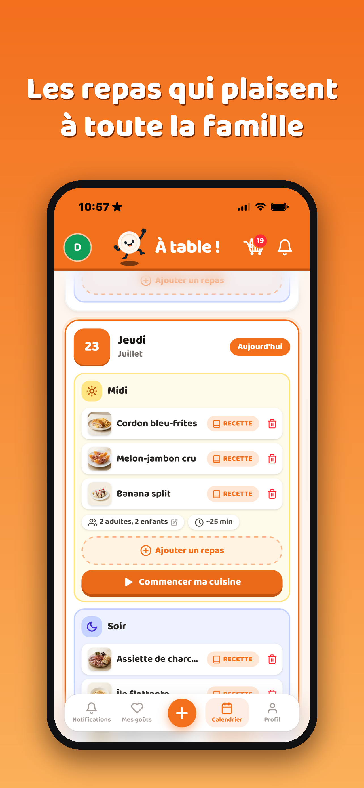
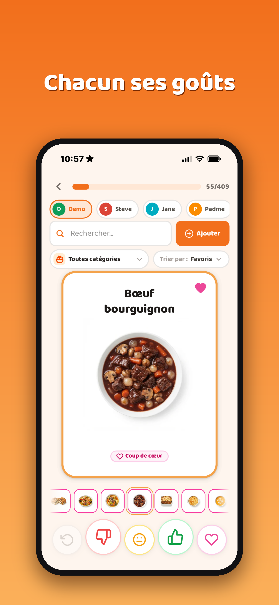
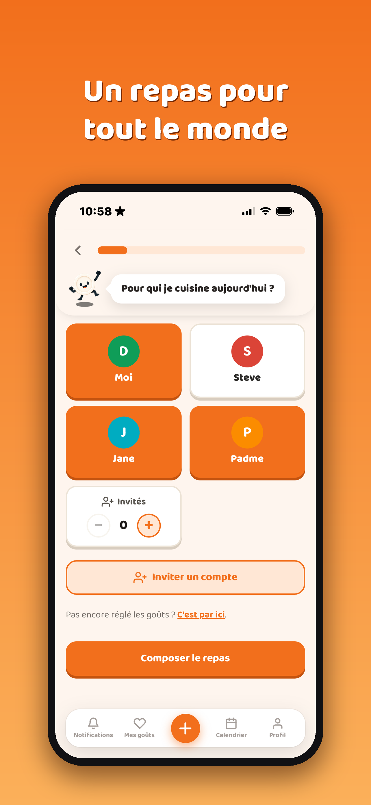
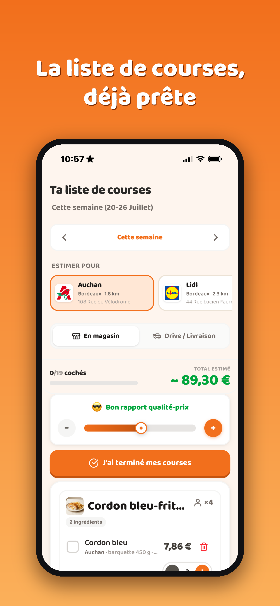
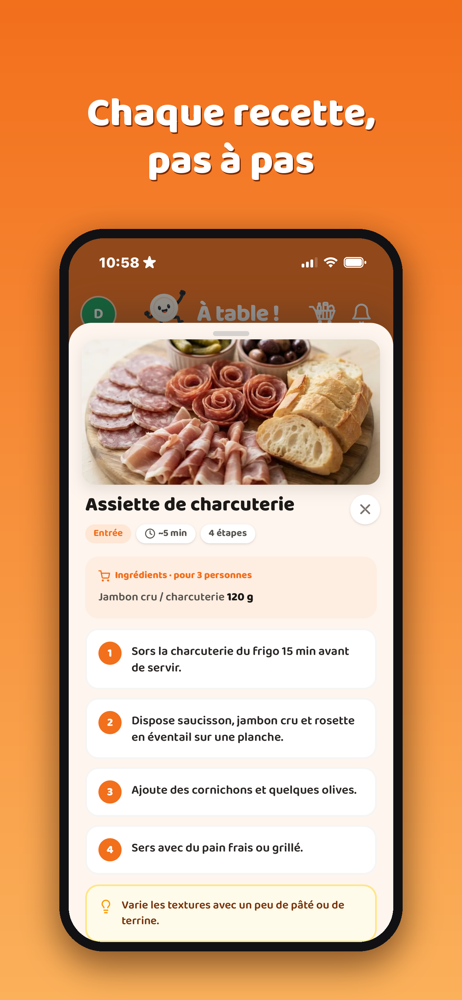

<div align="center">


# Atable

**Everyone's tastes, and meal ideas the whole family actually likes.**

A family meal-planning app: each person sets their food tastes, the app suggests
meals that work for everyone based on who's eating tonight, then builds the
shopping list.

<p>
  <a href="https://apps.apple.com/fr/app/ataaable/id6789919604">
    
  </a>
  &nbsp;&nbsp;
  <a href="https://a-taaaable.vercel.app">
    
  </a>
</p>

**📱 Live on the App Store** · 🌐 or try it instantly in your browser (PWA) — no install.

</div>

---

## Preview

<p align="center">
  
  
  
  
  
</p>

## Features

- 👨‍👩‍👧‍👦 **Family / group** — multiple members, each with their own profile and tastes; invite by code.
- 👍 **Taste deck** — swipe through foods (like / neutral / dislike / favorite) in a card-style UI.
- 🍽️ **Meal generation** — pick who's eating, and the app suggests starters / mains / desserts, prioritizing what pleases **everyone**.
- 🛒 **Shopping list** — built from the week's meals, with a **per-store price estimate** and checkable items.
- 👨‍🍳 **Cooking mode** — step-by-step recipes with checkable steps and a bit of gamification to see it through.
- 🥦 **Diets** — gluten-free, lactose-free, vegetarian, vegan, pescetarian… automatically filter the foods.
- 🔐 **Auth** — email or **Sign in with Google / Apple** (native iOS + web).
- 📱 **Cross-platform** — installable PWA + native iOS app via Capacitor (a shell that loads the hosted app).
- 🖼️ **166 generated dish photos** to make the catalog appetizing.

## Stack

| | |
|---|---|
| **Framework** | Next.js 16 (App Router, SSR) · React 19 |
| **Styling** | Tailwind CSS v4 · `motion` (animations) |
| **Database** | Neon Postgres (serverless) |
| **Social auth** | `@capgo/capacitor-social-login` + server-side ID-token verification (`jose`, JWKS) |
| **iOS** | Capacitor 8 (SPM) · Codemagic cloud build · [live on the App Store](https://apps.apple.com/fr/app/ataaable/id6789919604) |

## Architecture note

The app is **SSR** (server routes on Neon), so the iOS shell doesn't bundle a static build:
it loads the hosted URL in a WebView. As a result, UI changes ship **instantly** on native
(via the web deploy); only native changes (plugins, `Info.plist`, entitlements) need a new build.
Google/Apple ID tokens are verified by JWKS signature on the server (no client secret required).

## Development

```bash
npm install
cp .env.example .env.local   # paste your Neon DATABASE_URL
npm run dev
```

Tables are created automatically on the first request.

## License

© 2026 — All rights reserved.

This repository is **public for demonstration purposes** (portfolio). The code is **not** released
under an open-source license: no permission is granted to reuse, redistribute, or deploy it, and
contributions are not open.
